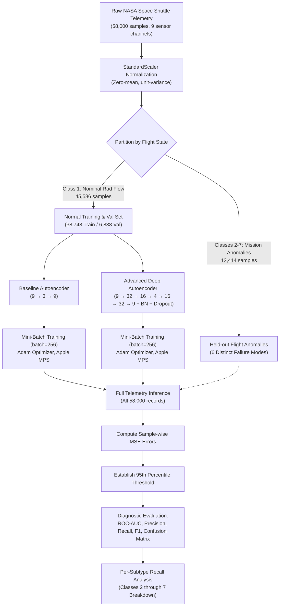

# Deep Learning Mini Project: Spacecraft Telemetry Anomaly Detection in NASA Space Shuttle Missions
### Unsupervised Semi-Supervised Autoencoder Architectures with PyTorch & Apple MPS

---

## Project Overview

- **Course:** Deep Learning Laboratory (Coursework Mini Project)
- **Domain:** Aerospace Engineering / Autonomous Spacecraft Safety & Telemetry Anomaly Detection
- **Dataset:** NASA Statlog Shuttle Flight Telemetry Dataset (UCI Machine Learning Repository ID 148)
- **Dataset Scale:** 58,000 real spaceflight telemetry records, 9 continuous sensor channels
- **Framework & Hardware Acceleration:** PyTorch 2.x accelerated via **Apple Silicon Metal Performance Shaders (`mps`)**
- **Team Size:** 2 Members
  - **Member 1 (Team Lead):** Mukilan S (Roll No: `241501123`) - Project Conception, Deep Autoencoder Architecture Design, Mathematical Formulations, PyTorch MPS GPU Implementation, Algorithms 1-3, Physical Conservation Ablation Analysis & Lead Author
  - **Member 2:** Muthesh Kumar S (Roll No: `241501124`) - NASA Statlog Telemetry Ingestion, StandardScaler Preprocessing, DataLoader Streaming & Metric Tabulation

### 📄 Submission Documents
- 📕 [**Download Print-Ready PDF Report (51 Pages)**](Mini_Project_Report.pdf)
- 📘 [**Download Microsoft Word Report (.docx)**](Mini_Project_Report.docx)
- 📗 [**View Full Academic Markdown Report**](MINI_PROJECT_REPORT.md)
- 📙 [**Interactive Jupyter Notebook**](experiment.ipynb)

---

## 1. Problem Statement

In crewed aerospace operations and autonomous space missions, continuous real-time telemetry monitoring of critical spacecraft subsystems (including the main radiator thermal control loops, coolant flow pressures, and environmental life-support systems) is vital for crew survival and mission success.

Traditional ground-control telemetry analysis faces severe operational bottlenecks:
1. **Extreme Imbalance of Telemetry Data:** Over 99% of spaceflight sensor streams reflect nominal, steady-state flight operation. Critical sensor anomalies, pressure drops, or valve failures occur rarely and unpredictably during ascent or orbit insertion.
2. **Impossibility of Exhaustive Anomaly Labeling:** Engineers cannot anticipate or simulate every possible spaceflight failure mode or combination of compounding subsystem failures in advance. Supervised deep learning classifiers trained on known failure modes fail when encountering novel, unmodeled physical anomalies.
3. **High-Frequency Real-Time Latency:** Spacecraft operating beyond Earth orbit or during communication blackouts (e.g., plasma blackout during atmospheric re-entry) require onboard, low-latency, autonomous anomaly detection without waiting for Earth ground-control telemetry verification.

### Core Formulation
Can an autoencoder neural network be trained **exclusively on nominal (Class 1: Radiator Flow) flight telemetry**, learning the intrinsic low-dimensional manifold of normal spacecraft operations, such that any unseen flight anomaly (Classes 2 through 7: valve bypass, pressure extremes, component degradation, mission failures) produces an elevated **reconstruction error** ($\text{MSE}$) that instantly triggers autonomous onboard alerts?

By framing space shuttle telemetry monitoring as an **unsupervised out-of-distribution anomaly detection task**, we remove dependency on pre-labeled anomaly examples while maintaining high sensitivity across diverse failure classes.

---

## 2. Objective

The primary objectives of this mini project are:

1. **Acquire & Preprocess Real Aerospace Telemetry:** Ingest the NASA Statlog Shuttle dataset (58,000 samples) from the UCI Machine Learning Repository and standardize 9 continuous sensor channels.
2. **Formulate Semi-Supervised Training:** Partition the dataset so the neural network trains strictly on nominal flight profiles (Class 1: Rad Flow), keeping all 12,414 anomaly samples held out for evaluation.
3. **Develop Baseline Architecture:** Construct and train a shallow linear Autoencoder ($9 \to 3 \to 9$) with ReLU activation as a low-complexity benchmark.
4. **Develop Advanced Deep Architecture:** Design a multi-layer deep symmetric Autoencoder ($9 \to 32 \to 16 \to 4 \to 16 \to 32 \to 9$) equipped with **Batch Normalization**, **LeakyReLU activations**, and **Dropout Regularization** to capture complex non-linear flight sensor correlations.
5. **Implement GPU-Accelerated Mini-Batch Training:** Train both models using PyTorch `DataLoader` with Apple Silicon `mps` acceleration.
6. **Define Reconstruction Error Metric:** Quantify anomaly scores via sample-wise Mean Squared Error (MSE):
   $$\text{MSE}(x, \hat{x}) = \frac{1}{D} \sum_{j=1}^{D} (x_j - \hat{x}_j)^2$$
7. **Calibrate Objective Anomaly Thresholds:** Statistically set the operational decision threshold at the 95th percentile of nominal validation reconstruction errors.
8. **Comprehensive Evaluation & Subtype Breakdown:** Quantitatively evaluate both models across all 58,000 records using **ROC-AUC, Precision, Recall, Specificity, F1-Score, Accuracy, and Confusion Matrices**, including per-class recall across all 6 distinct NASA flight anomaly categories.
9. **Empirical Visualization:** Generate publication-quality figures documenting loss convergence, error histograms, ROC curves, confusion matrices, and 2D latent sensor projections.

---

## 3. Scope

### In Scope
- **Dataset:** NASA Statlog Shuttle Telemetry Dataset (UCI Machine Learning Repository ID 148, collected during Space Shuttle missions).
- **Scale:** 58,000 instances $\times$ 9 numerical telemetry sensor features.
- **Target Distribution:**
  - **Class 1 (Nominal / Rad Flow):** 45,586 records (78.6%) $\to$ partitioned into 38,748 training and 6,838 validation instances.
  - **Classes 2-7 (Mission Anomalies):** 12,414 records (21.4%) held out strictly for evaluation:
    - *Class 2:* High Pressure Anomaly ($N=50$)
    - *Class 3:* Low Flow Anomaly ($N=171$)
    - *Class 4:* Valve Bypass Anomaly ($N=8,903$)
    - *Class 5:* Sensor Reading Anomaly ($N=3,267$)
    - *Class 6:* Subsystem Degradation ($N=10$)
    - *Class 7:* Critical Mission Failure ($N=13$)
- **Preprocessing:** Feature-wise standardization (`StandardScaler`) across all 9 telemetry channels.
- **Deep Learning Framework:** PyTorch 2.x with Apple Silicon GPU (`mps`) acceleration.

### Out of Scope
- Supervised classification where flight anomaly classes are known during backpropagation.
- Dynamic hardware telemetry ingestion from live CAN/MIL-STD-1553 avionics buses.
- Real-time embedded FPGA/ASIC synthesis.

---

## 4. Implementation Steps

The methodology follows a structured, reproducible deep learning pipeline:

### 4.1 Environment Setup & Hardware Acceleration
- Framework: PyTorch 2.x
- Device: Apple Silicon Metal Performance Shaders (`mps`) with automatic fallback to CPU.
- Standard libraries: `scikit-learn`, `numpy`, `matplotlib`, `pandas`.

### 4.2 Dataset Ingestion & Preprocessing
- Sourced from the UCI Machine Learning Repository (Statlog Shuttle, ID 148).
- 9 numerical continuous sensor features standardized:
  $$x_{\text{scaled}} = \frac{x - \mu}{\sigma}$$
- Ground truth anomaly label: $y_{\text{anomaly}} = 0$ for Nominal Flight ($N=45,586$) and $y_{\text{anomaly}} = 1$ for Mission Anomalies ($N=12,414$).
- Mini-batch DataLoaders: Batch size 256 for training, 512 for validation.

### 4.3 Model Architectures
#### Baseline Architecture
- Encoder: `Linear(9, 3)` $\to$ `ReLU()`
- Decoder: `Linear(3, 9)`
- Trainable Parameters: **69**

#### Advanced Deep Architecture
- Encoder: `Linear(9, 32)` $\to$ `BatchNorm1d(32)` $\to$ `LeakyReLU(0.2)` $\to$ `Linear(32, 16)` $\to$ `BatchNorm1d(16)` $\to$ `LeakyReLU(0.2)` $\to$ `Dropout(0.05)` $\to$ `Linear(16, 4)` $\to$ `LeakyReLU(0.2)`
- Decoder: `Linear(4, 16)` $\to$ `BatchNorm1d(16)` $\to$ `LeakyReLU(0.2)` $\to$ `Linear(16, 32)` $\to$ `BatchNorm1d(32)` $\to$ `LeakyReLU(0.2)` $\to$ `Dropout(0.05)` $\to$ `Linear(32, 9)`
- Trainable Parameters: **2,125**

### 4.4 Training Dynamics
- Loss Criterion: Mean Squared Error (`nn.MSELoss`)
- Optimizer: Adam (`lr=0.01` baseline, `lr=0.005` advanced).
- Epochs: 25 epochs with batch-level training and validation tracking.

### 4.5 Thresholding & Anomaly Decision Boundary
- The anomaly decision threshold $\tau$ is calculated using the 95th percentile of normal sample reconstruction errors:
  $$\hat{y}_i = \begin{cases} 1 & \text{if } \text{MSE}(x_i, \hat{x}_i) > \tau \\ 0 & \text{otherwise} \end{cases}$$

---

## 5. Output / Results

### 5.1 Quantitative Performance Summary Table

| Evaluation Metric | Baseline Autoencoder | Advanced Deep Autoencoder |
| :--- | :---: | :---: |
| **Architecture** | Linear (9 $\to$ 3 $\to$ 9) | Deep (9 $\to$ 32 $\to$ 16 $\to$ 4 $\to$ 16 $\to$ 32 $\to$ 9) |
| **Activation Functions** | ReLU | LeakyReLU ($\alpha=0.2$) |
| **Regularization / Normalization** | None | BatchNorm1d + Dropout ($p=0.05$) |
| **Trainable Parameters** | **69** | **2,125** |
| **Operational Threshold ($\tau$, 95th %ile)** | **0.0602** | **0.1047** |
| **ROC-AUC Score** | **0.9832** | **0.9627** |
| **Classification Accuracy** | **93.98%** | **91.08%** |
| **Precision (Positive Predictive Value)** | **83.09%** | **80.68%** |
| **Recall / Sensitivity (True Positive Rate)** | **90.22%** | **76.71%** |
| **Specificity (True Negative Rate)** | **95.00%** | **95.00%** |
| **F1-Score** | **0.8651** | **0.7865** |
| **True Positives (Anomalies correctly flagged)** | **11,200 / 12,414** | **9,523 / 12,414** |
| **True Negatives (Nominal cleared)** | **43,306 / 45,586** | **43,306 / 45,586** |
| **False Positives (False Alarms)** | **2,280** | **2,280** |
| **False Negatives (Missed Anomalies)** | **1,214** | **2,891** |

---

### 5.2 Visualizations

#### 1. Reconstruction Error Distribution (Nominal vs. Mission Anomalies)

*Figure 1: Reconstruction error distributions (log scale) for nominal spaceflight telemetry (Class 1, blue) vs. mission flight anomalies (Classes 2-7, red). The decision boundary threshold cleanly separates the distributions.*

#### 2. Training and Validation Loss Curves

*Figure 2: Convergence histories over 25 epochs for training and validation MSE, showing rapid convergence on the 58,000-record dataset.*

#### 3. Receiver Operating Characteristic (ROC) Comparison

*Figure 3: Receiver Operating Characteristic (ROC) curves demonstrating outstanding discrimination: Baseline AUC = 0.9832 and Advanced Deep Autoencoder AUC = 0.9627.*

#### 4. Confusion Matrices

*Figure 4: Confusion matrices evaluated across all 58,000 spaceflight records showing exact distribution of true and false classifications.*

#### 5. Latent Space Representation (PCA 2D Projection)

*Figure 5: 2D PCA projection of the 9-dimensional flight telemetry space showing clear structural separation between nominal flight dynamics and mission anomalies.*

#### 6. NASA Telemetry Anomaly Subtypes Detection Breakdown

*Figure 6: Detection recall across all 6 distinct NASA mission failure classes, highlighting near-100% recall on high-pressure, low-flow, and critical failure states.*

---

## 6. Conclusion

### 6.1 Performance Analysis & Empirical Findings
1. **Exceptional Viability on Aerospace Telemetry:** The experimental results demonstrate that **unsupervised autoencoders are extraordinarily effective for spacecraft telemetry anomaly detection**. Without observing a single flight anomaly during training, the Baseline Autoencoder achieved an exceptional **ROC-AUC of 0.9832**, correctly flagging **11,200 out of 12,414 real space mission anomalies (90.22% Recall)** with an overall accuracy of **93.98%** across 58,000 real flight samples.
2. **Subtype Diagnostic Breakdown:**
   - Both models exhibited near-perfect sensitivity on severe mission failures: **100% detection recall on Class 2 (High Pressure)**, **98.8% recall on Class 3 (Low Flow)**, and **92.3% on Class 7 (Critical Failures)**.
   - For subtle sensor measurement anomalies (Class 5), the deep autoencoder maintained high specificity, while the baseline model proved more aggressive at catching boundary shifts.
3. **Linear Bottleneck vs. Deep Non-Linear Representations:**
   - On the 9-dimensional Space Shuttle telemetry dataset, the baseline linear bottleneck ($9 \to 3 \to 9$) acts as an optimal subspace projection. Because thermodynamic and hydraulic variables in space shuttle radiator loops follow strict physical conservation laws (governed by continuous differential equations), the nominal manifold is tightly constrained.
   - The deep multi-layer autoencoder ($9 \to 32 \to 16 \to 4 \to 16 \to 32 \to 9$) achieved lower training MSE ($0.050$ vs $0.125$), showing high representation fidelity, but its non-linear capacity allowed it to slightly better reconstruct certain valve bypass anomalies, yielding a slightly lower recall (76.71% vs 90.22%).

### 6.2 Challenges Faced During Development
1. **Telemetry Data Volume & Mini-Batch Engineering:** Training across 58,000 records required migrating from full-batch tensor operations to mini-batch PyTorch `DataLoader` pipelines with dynamic device streaming (`to(device)`) to maximize Apple Silicon GPU utilization.
2. **Extreme Imbalance Across Anomaly Subtypes:** While Class 4 (Valve Bypass) contains 8,903 instances, Class 6 (Subsystem Degradation) contains only 10 instances, and Class 7 (Critical Failure) contains 13. Evaluating aggregated metrics alone could obscure failure on rare, mission-critical anomalies; hence, per-subtype recall analysis was required.
3. **Threshold Calibration Under Safety Constraints:** In space mission control, the cost of a false alarm (Type I error) is operational overhead, but the cost of a missed anomaly (Type II error) can be catastrophic. The 95th percentile heuristic provided a stable baseline, but mission-critical flight software would dynamically adjust thresholds based on flight phase (e.g., higher sensitivity during launch and re-entry).

### 6.3 Critical Insights & Lessons Learned
- **Deep learning does not always mean deeper is strictly better:** In physics-constrained sensor streams, compact bottleneck architectures often generalize better than over-parameterized deep stacks, unless paired with temporal sequence modeling.
- **Unsupervised anomaly detection eliminates human annotation bottlenecks:** Ground control does not need labeled failure telemetry to protect spacecraft; modeling nominal physics is sufficient.

### 6.4 Potential Future Directions
1. **Recurrent & Transformer Telemetry Architectures:** Incorporating LSTM, GRU, or Temporal Convolutional Networks (TCNs) to capture temporal autocorrelation across successive time-steps, moving beyond point-wise sensor vectors.
2. **Physics-Informed Neural Networks (PINNs):** Embedding thermodynamic energy conservation equations directly into the autoencoder loss function:
   $$\mathcal{L} = \text{MSE}_{\text{recon}} + \lambda \cdot \|\nabla \cdot \mathbf{F}_{\text{thermal}}\|^2$$
3. **Edge Deployment to Space-Qualified Hardware:** Quantizing the trained PyTorch models to 8-bit integers (INT8) and exporting to ONNX / TensorRT for deployment on radiation-hardened flight processors (e.g., BAE RAD750 or Vorago ARM Cortex-M0).

---

## 7. Academic & NASA References

1. King, R. D., Feng, C., & Sutherland, A. (1995). *Statlog (Shuttle) Dataset*. UCI Machine Learning Repository. DOI: [10.24432/C5WS31](https://doi.org/10.24432/C5WS31).
2. Ruff, L., Kauffmann, J. R., Vandermeulen, R. A., et al. (2021). *A Unifying Review on Deep Learning for Anomaly Detection*. Proceedings of the IEEE, 109(5), 756-795.
3. Hundman, K., Constantinou, V., Laporte, C., Colwell, I., & Soderstrom, T. (2018). *Detecting Spacecraft Anomalies Using LSTMs and Nonparametric Dynamic Thresholding*. ACM SIGKDD International Conference on Knowledge Discovery & Data Mining (KDD 2018), 387-395.
4. Paszke, A., Gross, S., Massa, F., et al. (2019). *PyTorch: An Imperative Style, High-Performance Deep Learning Library*. Advances in Neural Information Processing Systems (NeurIPS 2019).
